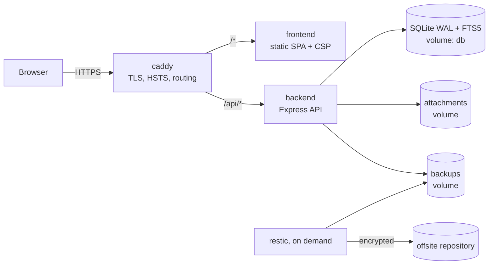

# UniNotes V1: implementation notes

How the system is built, the decisions behind it, and the policies that govern your data.

## Architecture



- **Same-origin:** the browser only ever talks to one origin. In development, Vite proxies `/api`; in production, Caddy does. Cookies stay `SameSite=Lax` and no CORS is needed.
- The **frontend** is a static SPA built by Vite and served by an unprivileged Caddy with the CSP. It holds no secrets.
- The **backend** owns all data. SQLite is embedded (no separate database container). Attachments live on a separate volume, not as BLOBs.

## Backend structure

```text
src/
  server.ts         startup: config → DB → migration gate → HTTP server → hourly maintenance
  app.ts            middleware order: logging → security headers → no-store → JSON limit → session → CSRF → routes → errors
  config.ts         Zod-validated environment
  db/               schema.ts (Drizzle), client.ts (pragmas), migrations.ts (status/apply)
  lib/route.ts      defineRoute(): auth + Zod validation + response envelope + OpenAPI registration
  middleware/       auth (session loader), csrf, rate limits, errors, security headers
  services/         business logic (notes, modules, versions, tags, search index, attachments,
                    import, export, sessions, MFA, audit, users)
  routes/           thin HTTP adapters over services
scripts/            CLI entry points (compiled into the image)
```

## Frontend structure

```text
src/
  router.tsx        routes, lazy loading per page
  api/              TanStack Query hooks per resource; lib/api.ts is the fetch wrapper (CSRF, error envelope)
  components/ui/    shadcn-style primitives on Radix (dialog, dropdown, tabs, tooltip, popover, switch…)
  components/layout AppShell, Sidebar (collapsible), TopBar (breadcrumbs, Ctrl+K), mobile drawer, guards
  components/editor CodeMirror 6 wrapper, formatting commands, toolbar
  components/markdown  sanitised renderer, Shiki code blocks, sandboxed Mermaid
  components/notes  cards, filters, tag input, save indicator, version history, conflict dialog, attachments, import
  hooks/useAutosave the save state machine
  pages/            Dashboard, Notes, Note editor, Modules, Module detail, Calendar, Search, Archive, Settings/*
```

The design tokens are CSS variables in `src/index.css` (light and dark palettes from the specification), mapped to Tailwind colours (`bg-surface`, `text-muted-foreground`…). Components never hard-code colours. Two adjustments were made for WCAG AA: in the dark theme, filled buttons use `#2563EB`, because white text on `#3B82F6` is 3.7:1; and destructive buttons use `#DC2626`. The specified accent and danger colours are still used for text, links and focus rings, where they pass contrast checks.

## Key decisions and deviations

| Topic | Decision | Reason |
|---|---|---|
| TypeScript | 6.0 instead of 7.0 | `typescript-eslint` supports TypeScript below 6.1, and the spec requires ESLint |
| Sessions | Own small implementation (the approach Lucia recommends after its deprecation) | Fully tested; tokens hashed at rest; no unmaintained dependency |
| TOTP | Implemented on `node:crypto` | About 60 lines, verified against the RFC 6238 vectors; avoids a dependency with frequent major API changes |
| shadcn/ui | Components written in the shadcn pattern on the unified `radix-ui` package | The shadcn CLI is interactive and network-bound; the result is the same copy-in code |
| Drizzle | 0.45 (stable), not the 1.0 beta | Stability |
| FTS | A standalone FTS5 table updated in the same transaction as each mutation | The indexed document combines note, tag and module data, which triggers cannot express cleanly |
| Mermaid | Rendered to SVG, then displayed as an `` data URI | Defence in depth: SVG in an `` cannot execute script |
| Shiki | Core build with the JavaScript regex engine and lazy grammars | No WebAssembly or `unsafe-eval` under the CSP; small initial bundle |
| External images | Not loaded; shown as links | Privacy, and the strict `img-src` CSP |
| Edge proxy health | Retry-on-dial (`lb_try_duration`) instead of active health checks | Avoids up to 30 seconds of 503s after a backend restart |
| ACME email | Not configured | Let's Encrypt no longer requires an email or sends expiry notices |

## Data policies

**Notes and revisions.** Each note has a `revision`. Title or content updates must send the revision the client last saw. A stale revision returns 409 with the current server copy, and nothing is written. Metadata changes (module, lecture date, tags, favourite) do not bump or require the revision, so starring a note in a list never causes a spurious conflict in an open editor.

**Autosave (client).** Saves are debounced by 1 second, with only one request in flight at a time; edits made meanwhile trigger a follow-up save. "Saved" is shown only once the server has confirmed the exact current text. Network errors are retried with backoff (2 s → 30 s). A conflict stops autosaving and opens a dialog with these choices: overwrite with mine, discard mine, save mine as a new note, or copy/download mine. Navigation is blocked while changes are unsaved: the app first tries to save, then asks. The browser's `beforeunload` prompt is also used.

**Version retention.**

- Before a content save, the previous state is stored as a version, at most once per `VERSION_INTERVAL_MINUTES` (default 10), so versions are never created per keystroke.
- "Save version" captures the current state on demand.
- A restore stores the pre-restore state, then makes the restored content a **new revision** and records it. History is never rewritten.
- The newest `VERSION_RETENTION` (default 100) versions per note are kept.
- Versions are deleted only when their note is permanently deleted.

**Archive vs. recycle bin.** Archiving hides a note or module from default views; archived items stay searchable through filters. Deleting moves a note to the recycle bin (`deleted_at`), from which it can be restored. Permanent deletion is only possible from the bin, needs confirmation, and removes versions, tag links, the FTS row and any attachments no other note still references. Optionally, `RECYCLE_BIN_RETENTION_DAYS` purges old bin items automatically.

**Module deletion.** Deleting a module requires typing its name. Its notes are kept and become unassigned. Archiving a module is the non-destructive alternative.

**Lecture dates.** These are stored as `YYYY-MM-DD` text and interpreted as local calendar dates in the browser, so they never shift across time zones. The calendar groups notes by lecture date, not by creation time. Historical dates are supported (1900–2200).

**Import.** Accepts `.md` and `.markdown` files only; the file must be valid UTF-8 and contain no NUL bytes; size-limited. The original Markdown is preserved byte for byte, apart from line-ending normalisation. Front matter is only stripped when it was written by a UniNotes export (identified by `uninotes_id`), so re-imports don't stack headers. Each import stores a content hash; importing the same content again returns `DUPLICATE_IMPORT` unless the user explicitly asks for a second copy. Imports never overwrite existing notes.

**Export.** Markdown exports carry YAML front matter. ZIP exports rewrite `/api/attachments/<id>/content` links to relative `assets/<id8>-<name>.<ext>` paths, so the Markdown works offline; links to attachments outside the export are neutralised rather than left pointing at private URLs. The full export includes `manifest.json` (modules, notes with paths and metadata, attachments with SHA-256) and optional per-note version history.

## Performance

- Every list and search is paginated (at most 100 per page); the browser never loads the whole database.
- Indexes cover the user, deletion state and updated/lecture dates; FTS5 has prefix indexes for fast partial-word search.
- The editor (CodeMirror), Markdown renderer (KaTeX, remark), Mermaid and every Shiki grammar are separate lazy chunks; dashboard pages don't download them.
- Built assets are content-hashed and cached as immutable; HTML is revalidated on every load.
- There is no polling: TanStack Query caches data and invalidates it after mutations.
- SQLite uses WAL mode with `synchronous=NORMAL` and a passive WAL checkpoint every hour.

## Verification performed for V1

- Backend: 91 Vitest/Supertest tests. Frontend: 47 Vitest/RTL tests. ESLint, strict typecheck and Prettier are clean in both. `npm audit --omit=dev` reports 0 vulnerabilities in both.
- Playwright: all 15 tests (13 desktop flows, a CSP-violation check, a mobile-viewport test) pass against a production build; the flows (except version restore, which needs a 0-minute snapshot interval) and the CSP test also pass against the full Docker stack.
- Docker: both images build; the stack starts with read-only root filesystems, non-root users and `cap_drop: ALL`; the backend has no published port; frontend and backend restart independently; data survives restarts.
- Backup and restore drill: local verified backup, restic upload with retention and `check`, deletion of all volumes, a fresh deploy, `restore.sh restic:latest`, then confirmation that notes, attachments, sign-in, search and image serving all worked.
